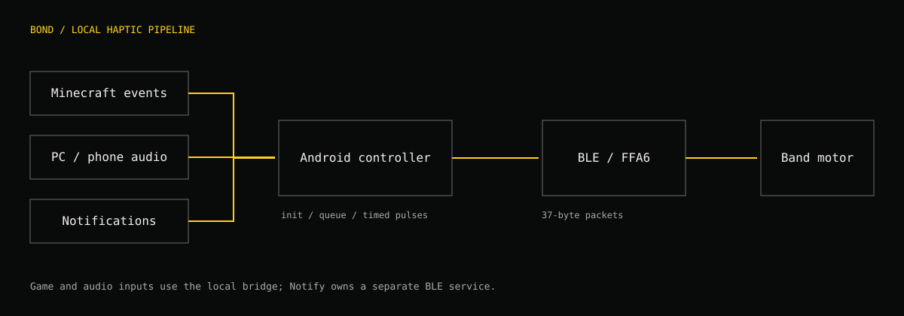
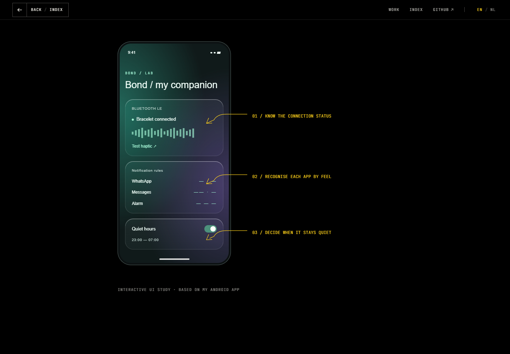
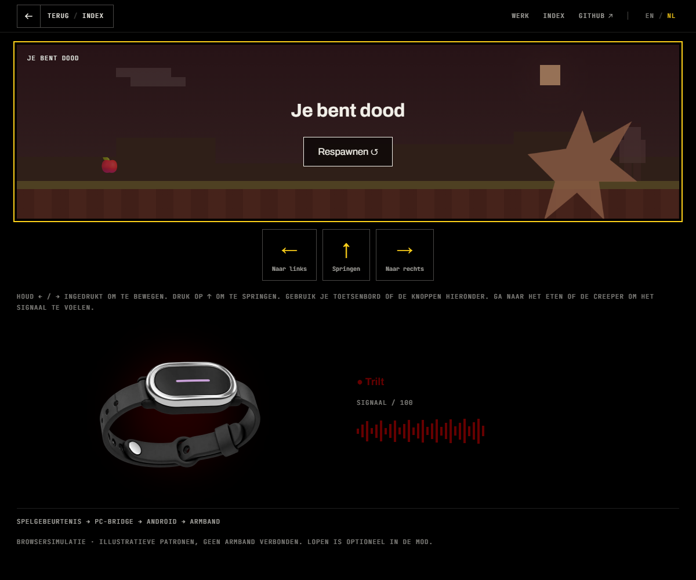
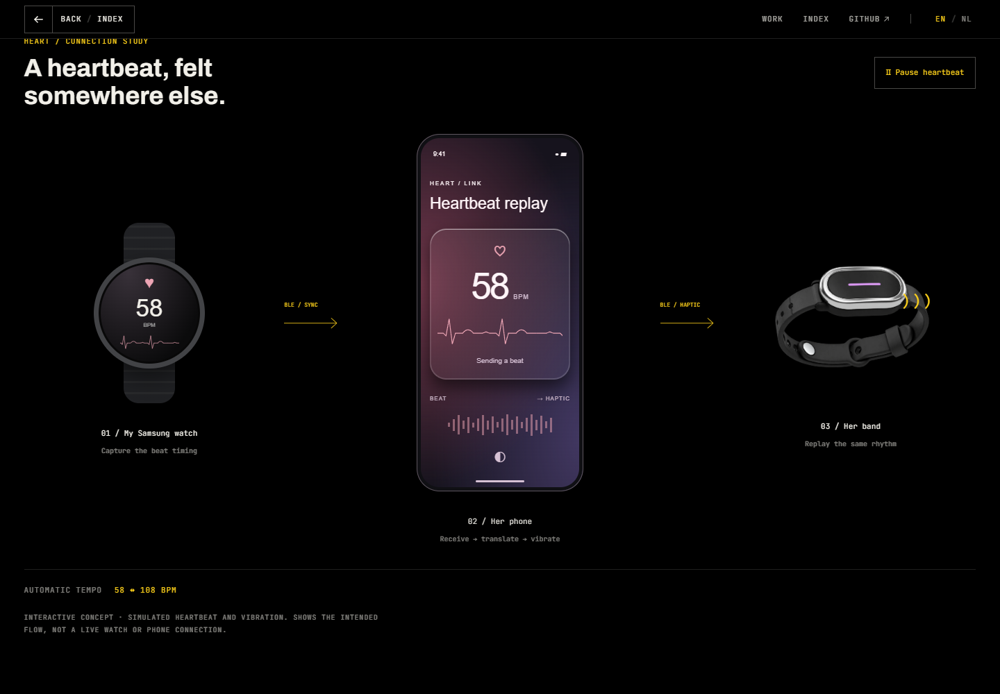

# Bond Touch — local BLE research and haptics

An independent controller for my own Bond Touch bracelet. I mapped the Android app’s Bluetooth protocol, tested the connection and vibration on a Band 4 Pop, then used that connection for Minecraft feedback, music-driven haptics and selected phone notifications.

This workspace contains original controller code and research notes. It is not an official Bond Touch product. [Official Bond Touch website](https://bond-touch.com/).




**[Full technical findings](research/FINDINGS.md) · [How the apps work](docs/HOW_IT_WORKS.md) · [BLE reference](research/notes/protocol-map.md) · [Decompiled-app research](research/decompiled-app/README.md)**

## A look at the project


*Portfolio UI concept based on the notification app’s features, not a screenshot of the installed Android app.*


*Playable portfolio simulation of the Minecraft haptic flow. The real NeoForge mod source is in `minecraft/mod`.*


*Watch → phone → band concept. The watch/ECG sharing implementation is not present in this source tree; this image illustrates the planned flow.*

## My role and learning approach

My main programming background is **C# and Unity**. This is an **AI-assisted learning project**, with substantial AI support for the unfamiliar Java/Android, Python and protocol-analysis work. I chose the goals, guided the experiments, tested on my hardware and used the results to learn.

The languages in this repository describe the tools used to build it. They are not a claim that I can independently develop in each language at the same level as C#. The project demonstrates curiosity, iteration, AI-assisted problem solving and hardware testing alongside my core game-development skills.

## Start here

- [Complete findings and BLE reference](research/FINDINGS.md)
- [Protocol map](research/notes/protocol-map.md)
- [Pairing and initialization](research/notes/initialization-sequence.md)
- [LED and stored-color commands](research/notes/color-command-map.md)
- [App flow analysis](research/notes/app-flow-map.md)
- [Research index and evidence notes](research/notes/index.md)

The reference snapshots preserve the original research, including open questions. The evidence summary below takes precedence over early “not yet tested” wording in those dated notes.

## What works, and what is still research?

| Area | Evidence / status |
| --- | --- |
| Band 4 Pop connection and motor output | Successful physical Android-app test recorded in the June 15 worklog |
| v2-family auth, state/event handlers and 37-byte motor packets | Implemented in both original Android controllers |
| Color output | Packet layout mapped; nonzero LED execute time identified after the first live vibration test; individual color/config modes need their own confirmation |
| Other generations | APK-derived maps for BT2, More/v3, BT4 and Mini; not a claim that every model was tested |
| More/v3 immediate vibration | `01 48 …` configures intensity/balance; whether it immediately rumbles still needs a live test |
| Notification app | Built and installed historically; per-device alarm behavior and background reliability require testing |
| Heartbeat/ECG portfolio illustration | Concept and project narrative; no standalone watch-to-partner implementation was found in this workspace |
| Portfolio previews | Browser simulations, not live BLE sessions |

The research distinguishes a BLE link from application readiness: commands should follow the generation-specific initialization and `CONNECTED` state. No universal periodic “keep-awake packet” or exact interval is established in the inspected controller source.

## Repository map

```text
apps/android/
  bridge/                 Original BLE controller + local HTTP/audio bridge
  notify/                 Separate notification/alarm companion
minecraft/
  mod/                    NeoForge 1.21.1 client mod and haptic-rule editor
  bridge/python/          Active lightweight PC forwarder
  bridge/dotnet/          Alternative Windows bridge implementation
audio/windows/            .NET 8 / NAudio loopback bass detector
tools/ble-probe/           Python Bleak scan, classify and packet helpers
research/
  FINDINGS.md             Complete research notebook
  notes/                  Protocol, auth, color, app-flow and dated test notes
  decompiled-app/         Methodology, source-class index and extraction tools
experiments/
  e87-badge/               Qix/JieLi badge probe and findings
  e87-bike-bridge/         Android bike-to-badge field tester
  super73/                S75/Super73 BLE map (physical bike test pending)
docs/
  HOW_IT_WORKS.md          Controller architecture and event-to-packet path
  images/                 Diagrams and clearly labeled portfolio concepts
```

Each project folder has its own entry-point README. The original mixed workspace and its build outputs remain untouched.

## Quick start: Android → bracelet

1. Configure Android Studio, JDK 17 and Android SDK 36. The Android projects target SDK 36 and require Android 8/API 26 or newer.
2. Set `ANDROID_HOME` (or create an ignored `local.properties` with `sdk.dir`) and set `JAVA_HOME` to JDK17. Machine-specific SDK/JDK paths have been removed from this published copy.
3. Build one controller:

```powershell
# From the workspace root
.\apps\android\bridge\gradlew.bat -p .\apps\android\bridge assembleDebug
# Or the separate notification app
.\apps\android\notify\gradlew.bat -p .\apps\android\notify assembleDebug
```

4. Install its `app/build/outputs/apk/debug/app-debug.apk` with Android Studio or `adb install -r PATH_TO_APK`.
5. Close the official app and other BLE controllers, grant Bluetooth permissions, wake the band and scan.
6. Select your band. Complete its physical confirmation prompt when requested. Wait for ready/state `85`, then test one short vibration.

The two custom Android controllers are alternatives; they should not compete for ownership of one bracelet’s connection. Notify Haptics additionally needs Android notification-listener access. Its alarms are detected from notifications, not from another app’s private schedule. Quiet hours are currently 23:00–07:00.

## Quick start: Python probe

```powershell
python -m venv tools/ble-probe/.venv
.\tools/ble-probe\.venv\Scripts\python.exe -m pip install -r tools/ble-probe/requirements.txt
.\tools/ble-probe\.venv\Scripts\python.exe tools/ble-probe/bond_ble_probe.py scan
.\tools/ble-probe\.venv\Scripts\python.exe tools/ble-probe/bond_ble_probe.py services --target "BOND"
.\tools/ble-probe\.venv\Scripts\python.exe tools/ble-probe/bond_ble_probe.py classify --target "BOND"
# Offline: print packet examples without connecting
.\tools/ble-probe\.venv\Scripts\python.exe tools/ble-probe/bond_ble_probe.py payloads
```

The direct `vibrate-v2` probe sends a mapped packet; it does not implement the complete Android pairing/auth state machine. Discovering the characteristic is not enough to guarantee playback.

## Minecraft / BondCraft

```text
Minecraft event → in-game rule → POST localhost:8765/event
               → PC forwarder → Android :7878/event → BLE FFA6 → band
```

- Minecraft Java **1.21.1**, NeoForge **21.1.217**, JDK **21** for the mod.
- Build: `minecraft/mod/gradlew.bat -p minecraft/mod build`.
- Start the Android bridge and connect the band, then run `python minecraft/bridge/python/bondcraft_companion.py`.
- Use the phone host shown in Android, or USB ADB forwarding (`adb forward tcp:7878 tcp:7878`). Send a test before starting Minecraft.
- Install the built JAR in the instance’s `mods` directory. Press **B** for haptic settings.
- Connection config: `config/bondcraft-client.toml`. Detailed rules: `config/bondcraft-haptics.json`.
- Per-event pattern, strength, duration, color, cooldown and priority; global bounds, scale and burst limits. Optional Cobblemon battle cues are implemented without requiring Cobblemon for ordinary play.

Walking rules are disabled by default; enabling them is a user choice. The portfolio’s playable scene deliberately simplifies Minecraft and includes a brown food-color override.

## BLE reference at a glance

The Band 4 uses the v2-family service, **not the More/v3 manager**:

```text
service  d3c00002-add3-1d4b-0001-0000b5006bb1
FFA1     d3c0ffa1-add3-1d4b-0001-0000b5006bb1  token
FFA2     d3c0ffa2-add3-1d4b-0001-0000b5006bb1  local AUID (u32 LE)
FFA4     d3c0ffa4-add3-1d4b-0001-0000b5006bb1  state
FFA5     d3c0ffa5-add3-1d4b-0001-0000b5006bb1  events
FFA6     d3c0ffa6-add3-1d4b-0001-0000b5006bb1  commands
FFA8     d3c0ffa8-add3-1d4b-0001-0000b5006bb1  BT4/Mini bonding
```

| Trigger | Response |
| --- | --- |
| State `82` / waiting token | FFA1: `31 32 33 34 35 36 37 38` (literal ASCII `12345678` from the app, not an account credential) |
| State `83` / waiting AUID | FFA2: locally generated, persisted 4-byte little-endian identifier |
| FFA5 event `13` / paired signal | FFA6: `31 00 11 22 33 44` padded to 20 bytes |
| State `85` | Application-ready/connected |

The motor/color command is **37 bytes**, written to FFA6. Motor duration and LED execute duration are independent little-endian uint16 fields. A color can remain invisible when RGB is populated but LED execute time is zero.

```text
offset  0       26               LED_MOTOR_CTRL
        1       00               reserved
        2       queue
        3       motor strength   0..100 in Android controllers
        4..5    motor duration   u16 LE milliseconds
        6       LED mode         01 on / 02 breathe / 03 blink / 04 off
        7..9    red, green, blue
        10      brightness
        11..12  transition ms    u16 LE
        13..14  hold ms          u16 LE
        15..16  sleep ms         u16 LE
        17..18  LED execute ms   u16 LE
        19..36  zero padding
```

For every mapped UUID, state/event, opcode, queue/config format, v3 packet and generation caveat, see [FINDINGS.md](research/FINDINGS.md) and the linked reference snapshots.

## Limitations and evidence to collect next

- Capture and compare a complete successful setup and one motor/color command on each generation.
- Confirm v3 FFB2 duration units and header byte 0 (currently inferred as route/menu target).
- Resolve the v3 paired-event mismatch: constants say `16`, dispatch checks `13`.
- Capture FFA8 bonding, white-flash behavior and queue/busy timing.
- Measure background connection reliability and battery use instead of inferring savings from implementation choices.
- Local HTTP bridges are development tools: use a trusted local network or USB forwarding, not public internet exposure.

## Provenance and reuse

This is independent interoperability research using the author’s own hardware and a locally obtained Android app. Original protocol notes date to June 2026; Notify UI work and this documentation review date to October 2026. Historical test results are labeled as such; this documentation pass did not rerun physical BLE tests.

Do not treat the decompiled proprietary app, APKs, vendor firmware or product imagery as code licensed by this project. Original code and documentation are covered by the repository’s [MIT license](LICENSE). That license does not grant rights to proprietary vendor artifacts or third-party dependencies. The original NeoForge template used an All Rights Reserved placeholder; its inherited metadata has been aligned with this repository’s selected MIT license. Bond Touch names and product media belong to their respective owners. See the [official product site](https://bond-touch.com/).
