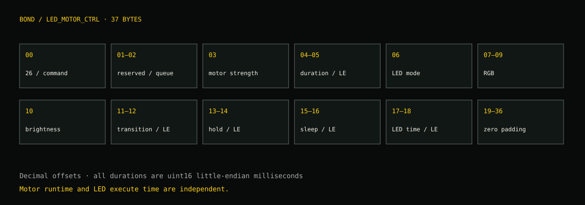

# How the controllers work

## One output protocol, several independent inputs

The bracelet is a BLE peripheral. The Android controller is the central that owns the GATT link. Minecraft, PC music and phone notifications supply events; the controller turns final patterns into timed motor/LED writes.


No vendor cloud API is needed for the local controller. The official app’s remote partner/social messaging is a different path. The source here does not implement a remote watch-to-partner relay; the portfolio heartbeat illustration is a concept.

## Android BLE bridge

Entry point: [`MainActivity.java`](../apps/android/bridge/app/src/main/java/com/marco/bondbandbridge/MainActivity.java), package`com.marco.bondbandbridge`. This is a native Java Activity, not a Kotlin/Compose application.

1. **Permissions and discovery.** Android Bluetooth permission gates scanning. Results match Bond names. Scan stops when connecting.
2. **GATT discovery.** Find the legacy user service, API characteristic, state/event/command characteristics and optional FFA8. Inspect generation rather than assuming “Band4” means v3.
3. **Notification setup.** Serialize CCCD writes and GATT operations; one Android GATT operation is outstanding at a time.
4. **Application initialization.** Subscribe/read state, answer state82 with the app’s literal token, state83 with the persisted local AUID, event13 with the paired-correct packet. State85 means application-ready.
5. **Input.** Test controls, Color Lab, HTTP bridge, phone audio capture and scheduled patterns enter the same command queue.
6. **Output.** A final pattern expands into delayed pulses; each pulse constructs a37-byte LED_MOTOR_CTRL packet and writes FFA6 with response/default write type.
7. **Lifecycle.** Connection state, reconnect handling and bridge screen-off locks are separate from the lightweight notification app. No universal periodic keep-alive opcode is established by this code review.

Color Lab supports selected-color buzz/show/hide, experimental breathe and persistent color settings. Motor runtime and LED runtime are independent. A zero LED execute time caused the early white-flash failure despite working motor output.

## Notify Haptics: the background companion

Source: [`apps/android/notify`](../apps/android/notify).

| Class | Responsibility |
| --- | --- |
| `MainActivity` | Permission/setup UI, scan/saved device controls, searchable app picker, per-app/alarm/pre-alarm editors |
| `GlassStyle` | Shared native gradient/rim/ripple drawing, theme-aware colors; no optical refraction or continuous background renderer |
| `BondConfig` | SharedPreferences state, rules, limits and serialization |
| `BondNotificationListener` | Event-driven posted/removed notification filtering, selected-package rules, alarm classification and quiet-hours decisions |
| `BondHapticService` | Foreground connected-device service, saved-device reconnect/backoff, auth state machine, queued pattern/LED output |

Normal notifications need a selected app rule. Own-app, noisy service/progress and inappropriate ongoing notifications are ignored. Rules define pattern, strength, duration, color and cooldown. Quiet hours are23:00–07:00.

Alarm notifications are not private alarm schedules. Upcoming warnings are distinguished from ringing alarms using the next-alarm clock/time guard plus notification text/actions. Pre-alarm has its own rule and cooldown. Alarm repeat ends when the relevant notification is removed. The app does not guarantee support for every clock’s wording.

The service starts only after configuration/permissions and a saved/enabled band. Stop Service disables reconnect and removes its quiet foreground notification. It avoids an indefinite wake lock and a polling loop. This is an implementation choice, not measured evidence of a week’s battery life.

## Minecraft

Sources: [`mod`](../minecraft/mod), [`Python bridge`](../minecraft/bridge/python), [`Android output`](../apps/android/bridge).

- `BondCraftClient` registers the client tick scanner.
- `MinecraftEventScanner` compares health, food, movement and world/entity state. It emits damage/heal/death/respawn, jumps/landings, tool/world and threat events with source-specific cooldowns. Optional Cobblemon screen detection adds battle cues.
- `HapticSettingsStore` loads defaults, merges existing configuration, sanitizes limits and applies enabled state, global scale, dynamic strength/duration and cooldown/burst controls.
- In-game **B** opens categories and per-event tuning; presets import/export JSON.
- `BridgeClient` posts the final pattern payload to localhost8765/event.
- The PC bridge forwards that same final JSON to the Android phone on7878/event. It does not reinterpret every game event or own game tuning.
- Android reads pattern/strength/duration/color/cooldown/priority and expands it into pulse writes.

Global defaults: strength15–100, duration25–1200ms, scale100%, cooldown80ms,22 events/10seconds for ordinary-priority rules. High-priority rules can bypass the normal burst rejection. Rule cooldown and scanner emission interval can both apply. See [all91 static defaults](../research/notes/minecraft-rule-defaults.md); calm mode/migration can adjust them.

```json
{
  "source": "bondcraft",
  "final": true,
  "event": "creeper_warning",
  "pattern": "warning",
  "strength": 66,
  "duration": 100,
  "cooldown": 700,
  "priority": 75,
  "color": "#4DFF4D"
}
```

This example is the base rule. Actual strength adds`round(max(0,8-distance)*6)` and clamps to global limits. Jump/landing and damage have their own adjustments. Walking/food-restored events are optional rather than all enabled by default.

### Android pulse expansion

| Pattern | Pulse start times / behavior |
| --- | --- |
| single |0ms |
| double |0, max(160,duration+105) |
| triple |0, max(160,duration+105), max(320,2×(duration+105)) |
| warning |0/180/360ms; strength increases+0/+10/+20, clamped |
| heartbeat |0/170/610/780ms; second/fourth pulses softer and capped at105ms |
| long | One pulse lasting at least700ms |
| ramp | Five pulses every160ms, increasing strength |
| rise | Four pulses every95ms, strength−30,+12 each step; duration capped95ms |
| fall | Four pulses every105ms, strength−12 each step; duration capped110ms |
| wave | Three pulses at0/110/250ms with varied strength/duration |
| stutter | Four pulses every80ms; duration capped55ms |
| breathe | LED breathe command, plus optional initial motor pulse |
| none | No output |

These are patterns from the bridge sender. The notification controller has its own rule/pattern implementation; do not assume every editor label schedules identical pulses across both apps.

## Music / bass haptics

Windows source: [`audio/windows`](../audio/windows), .NET8 Windows Forms and NAudio2.2.1. Captures playback loopback, detects bass hits and applies sensitivity/threshold/cooldown/burst and strength/duration controls before HTTP delivery to Android. The same Android bridge has phone playback-capture detection. Android asks for capture consent and some audio apps disallow capture.

## Packet construction



The authoritative original builders are`MainActivity.buildLedMotorCommand` and`BondHapticService.buildLedMotorCommand`. They allocate37 zeroed bytes; set command/strength/motor time/mode/RGB/brightness; write transition/hold/sleep/execute as u16LE; leave the remainder zero.

- `0x26` changes immediate motor/LED behavior.
- `0x27` is configuration. Write is24bytes, read20bytes; stored colors use a4-byte big-endian integer, unlike the little-endian durations.
- `0x31` is pairing confirmation, padded to20bytes in this family.
- `0x32` executes a queued pattern, with mode11 for normal or22 for meaning/color-interpolated messages.
- DFU/factory/reboot/reset identifiers in the research are a map, not a required setup sequence.

## Evidence and open issues

The June worklog reports a successful connection and vibration on Band4 Pop. It does not demonstrate every generation, every color setting, every alarm app or physical bike behavior. Original app decompilation establishes software branches and packet builders; live captures are still required for timing, v3 message units, FFA8 and exact firmware prompts.

Detailed evidence and historical questions: [complete notebook](../research/FINDINGS.md). Source notes retain dates and are not silently rewritten to sound like all tests passed.
